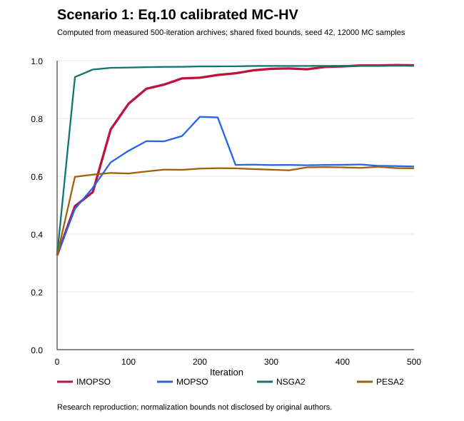
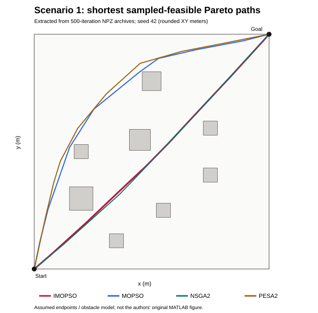
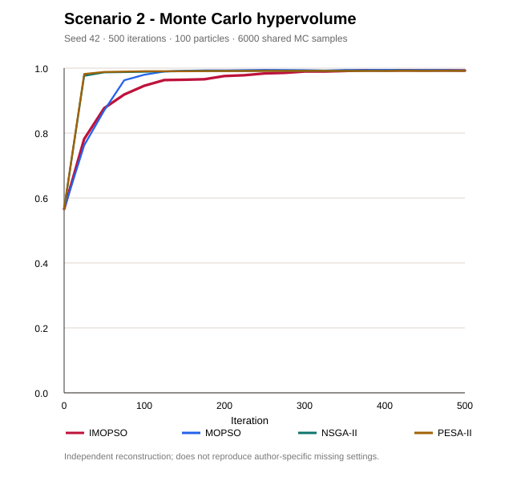
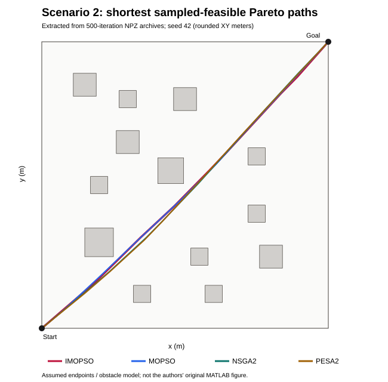

# IMOPSO-UAV3D-Repro

**Independent, executable reconstruction / 独立可运行复现** of:

> Xu Hang, Liao Yunpeng, Chen Chuze (2026). “Three-dimensional Urban Unmanned Aerial Vehicles Path Planning Based on Improved Multi-Objective Particle Swarm Optimization” / 徐航等：《基于改进多目标粒子群优化算法的三维城区无人机路径规划》. *Journal of Putian University / 莆田学院学报*, **33**(5), 92–100.

## What is reproduced / 复现内容

- Scenario 1 (8 buildings) and scenario 2 (13 buildings), 1 km × 1 km map, with 300 m-tall buildings; all plan coordinates transcribed from Table 1.
- Four minimization objectives from equations (2)–(8): normalized excess path length, clearance threat, altitude offset, mean turning angle.
- IMOPSO with particle-to-archive quality, decreasing mutation probability (11)–(15), expanded objective-space grids (16)–(18), adaptive sparse-grid leaders (19)–(21), and singleton-protective crowded-grid pruning (22)–(23).
- MOPSO, NSGA-II, PESA-II algorithm-family baselines, shared-seed Monte Carlo 4-D hypervolume, Pareto archives, top-view path maps, and HV curves.
- Repeatable command-line simulation, NumPy archive export, CSV summary, and unit tests.

## Run / 运行

```bash
python -m pip install -e ".[test]"
pytest -q
python -m imopso_uav3d.experiment --case both --algorithms imopso mopso nsga2 pesa2 \
  --iterations 500 --particles 100 --archive-size 50 --seed 42 --output results
```

Faster check / 快速验证：

```bash
python -m imopso_uav3d.experiment --case both --iterations 35 --particles 45 --archive-size 30 --seed 2026 --hv-samples 2000 --interval 5
```

The command writes `results/summary.csv`, individual `scenario_*_{algorithm}_seed_*.npz` / `.json`, and `scenario_*_hv.png` / `scenario_*_paths.png`.

## Reproduction boundaries / 复现边界

**This is not the authors' original MATLAB R2024a source, nor a verified numerical replication of their Table 2.** The paper does not fully specify the start/end nodes, waypoints count, altitude bounds, drone radius, safety margin, number of segment samples, grid cell count, mutation perturbation operator, benchmark implementation or experiment seeds. To make experiments executable, the implementation uses and clearly exposes these **non-paper assumptions**:

| Item / 参数 | Default / 默认值 | Provenance |
|---|---:|---|
| Start / goal | (0,0,200) / (1000,1000,200) m | Assumed (not explicit in paper) |
| Intermediate nodes | 8 | Assumed |
| z bounds | [120, 280] m | Assumed |
| Drone equivalent radius / safety distance | 5 m / 30 m | Assumed |
| Samples per segment | 11 | Assumed |
| Grid subdivision | 10 per objective | Assumed |
| IMOPSO Gaussian coordinate perturbation | std = 0.13 × coordinate range | Assumed (paper provides probability, not perturbation operator) |
| Ordinary MOPSO mutation | probability 0.1 | Assumed |
| Population / archive / PSO inertia / acceleration | 100 / 50 / 1 × 0.98 each iteration / c1=c2=1.5 | Paper section 4.1 |
| NSGA-II crossover / mutation rates | 0.7 / 0.3 | Paper section 4.1 |
| PESA-II crossover / mutation rates | 0.8 / 0.3 | Paper section 4.1 |
| Mutation probability caps / quality distance / grid expansion | 0.01–0.80 / threshold 0.5 / 0.1 | Paper sections 3.2–3.3 |
| Monte Carlo HV | 6000 samples, fixed random generator, reference [1,1,1,1] | Paper ref point; sample count assumed |

**Clarifications / 数值约定:** (1) The paper's threat formula uses 2D equivalent-circle distances even though the city objects are 3D cuboids; the default scorer follows the *written formula* (all-height XY exclusion), not a physical 3D box intersection. (2) Paper eq. (4) assigns infinite collision cost; to avoid `inf` contaminating archive grids and Monte Carlo HV, collisions receive a finite score `f2 >= 1` and feasible paths take archive priority. (3) Paper eq. (7) writes `arctan(cross/dot)`; this implementation uses `atan2(norm(cross), dot)` for the correctly unsigned [0,pi] turn angle. (4) NSGA-II/PESA-II operators are faithful algorithm-family implementations with independent, disclosed operator choices, not original unshared MATLAB code. (5) HV is computed from **raw objectives with one common fixed reference**, rather than independently min-max normalizing each algorithm's archive; this preserves comparability between algorithms.

## Reproducibility checks / 结果验证

The `tests/` suite checks scene construction, geometry, archive capacity, Pareto dominance, normalized HV and short smoke runs for all four algorithms. **Do not claim IMOPSO is better from a small smoke run.** Meaningful validation requires repeated seeds, common compute budgets, uncertainty intervals, and direct comparison to Table 2 on the same fully specified problem.

## Reference / 引用

This project is a third-party educational/research reproduction. Please cite the original paper; no author affiliation or endorsement is claimed.

## Three-dimensional view / 三维视图

```bash
python -m imopso_uav3d.visualize3d --results results --scenario 1 --seed 42
python -m imopso_uav3d.visualize3d --results results --scenario 2 --seed 42
```

The 3D bars use the 300 m heights published in the paper. The default optimizer's written threat equation nevertheless uses only horizontal distances, as disclosed above.
## Measured single-seed evidence / 单种子实测结果

Full run: 500 iterations, 100 particles, archive size 50, fixed seed 42; all four optimizers in both scenarios. [CSV summary](evidence/seed42_500iters_summary.csv) explains the raw numerical results.

| Scenario | IMOPSO | MOPSO | NSGA-II | PESA-II |
|---|---:|---:|---:|---:|
| Case 1 MC-HV | 0.9943 | 0.8620 | 0.9918 | 0.8552 |
| Case 2 MC-HV | 0.9927 | 0.9932 | 0.9922 | 0.9918 |






**Interpretation:** This independent implementation did not uniformly reproduce IMOPSO's reported superiority; in case 2 MOPSO was slightly higher in this single run. The paths and the two HV charts are generated from this implementation's outputs, **not digitized from the paper**.
